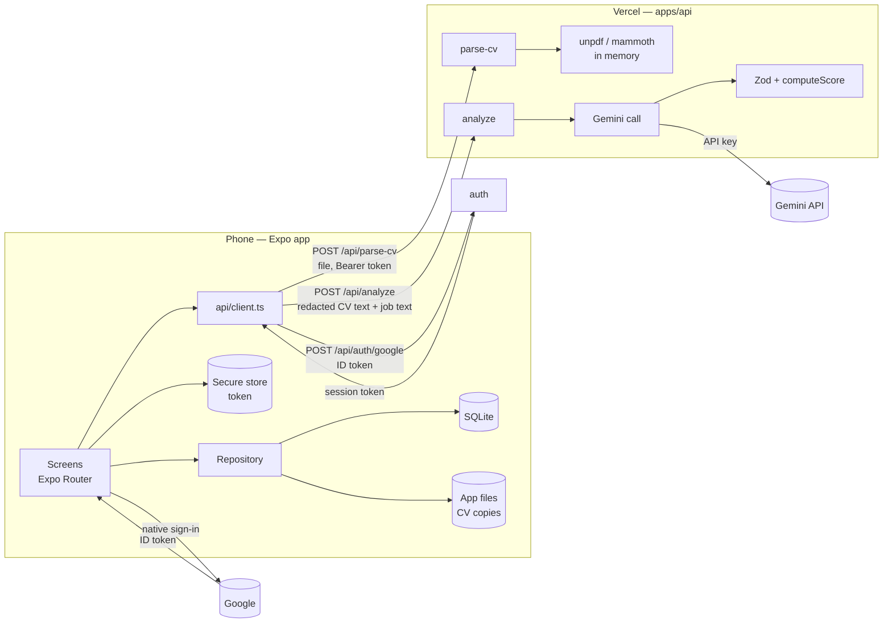

# Architecture — RoleRadar (Expo)

## 1. Overview

Two deployable parts and one shared package:

- **Mobile app** (`apps/mobile`, Expo + Expo Router): all screens, all user data (SQLite on the phone), the CV file copy, the auth token (secure storage).
- **API** (`apps/api`, Next.js route handlers on Vercel): Google ID-token verification + allow-list → RoleRadar session token, CV text extraction, and the Gemini call with validation and scoring. **Stateless — it stores nothing.**
- **Google** (native Google Sign-In on the phone): proves who the user is; RoleRadar never sees the Google password.
- **Core** (`packages/core`): Zod schemas, types, `computeScore`, `verdictFor`, `redactContactInfo`, labels, stats helpers — used by both.



**Trust boundary:** the app is untrusted (anyone can unpack an app and read its code). Secrets, prompt and scoring live on the API.

---

## 2. Monorepo

```
roleradar/
├── package.json                 # "workspaces": ["apps/*", "packages/*"], root scripts
├── apps/
│   ├── mobile/
│   │   ├── app.json / app.config.ts   # name, slug, scheme "roleradar", bundle IDs, plugins
│   │   ├── eas.json                   # build profiles (§9)
│   │   ├── app/                       # Expo Router routes (§3)
│   │   ├── src/
│   │   │   ├── components/ui/         # primitives mirroring Figma
│   │   │   ├── components/layout/     # Screen, KeyboardScreen, PageHeader, BottomActionBar, TabBar
│   │   │   ├── components/features/   # home/, cv/, analyze/, analysis/, history/, top-matches/, profile/
│   │   │   ├── theme/                 # tokens.ts, typography.ts, index.ts (generated from Figma)
│   │   │   ├── lib/api/               # client.ts (base URL, token, timeout, error mapping)
│   │   │   ├── lib/storage/           # repository.ts, sqlite.ts, migrations.ts, files.ts, export.ts
│   │   │   ├── lib/auth/              # google.ts (configure, signIn, signOut), session.ts (secure store), devLogin.ts (__DEV__ only)
│   │   │   └── hooks/                 # useOnline, useRepository queries, useReducedMotion
│   │   ├── assets/                    # icon.png, adaptive-icon.png, splash
│   │   └── e2e/                       # Maestro flows
│   └── api/
│       ├── src/app/api/
│       │   ├── auth/google/route.ts   # verify Google ID token → session token
│       │   ├── auth/dev/route.ts      # dev sign-in; 404 unless ALLOW_DEV_LOGIN=true and not production
│       │   ├── parse-cv/route.ts
│       │   └── analyze/route.ts
│       ├── src/lib/gemini/            # client.ts ("server-only"), prompts.ts, call.ts, mock.ts
│       ├── src/lib/cv/                # extract.ts (unpdf, mammoth), normalize.ts
│       └── src/lib/auth/              # google.ts (verifyIdToken via google-auth-library), session.ts (sign/verify HMAC tokens), allowlist.ts
├── packages/core/src/
│   ├── schema.ts      # Zod: AiAnalysis, AnalysisResult, requests/responses, export file
│   ├── scoring.ts     # computeScore, verdictFor, counts
│   ├── redact.ts      # redactContactInfo
│   ├── labels.ts      # verdict + status labels and code values
│   └── stats.ts       # weekly average, history counts, top matches selection
└── eval/              # golden-set.json, run-eval.ts
```

`packages/core` must stay **pure TypeScript** (no React Native or Node-only imports) so both apps can use it.

---

## 3. Navigation (Expo Router)

```
apps/mobile/app/
├── _layout.tsx                  # root Stack; fonts; DB init; GoogleSignin.configure; auth gate; share-intent handler (v1.1)
├── login.tsx                    # Continue with Google (+ dev sign-in in __DEV__)
├── (tabs)/
│   ├── _layout.tsx              # Tabs: Home, CV, History, Profile + centre (+) button
│   ├── index.tsx                # Home
│   ├── cv.tsx                   # Your CV
│   ├── history.tsx              # History
│   └── profile.tsx              # Profile
├── analyze.tsx                  # Quick analyze → Analyzing (two states, one screen)
├── analysis/[id].tsx            # Match analysis
├── top-matches.tsx              # v1.1
├── cv-version/[id].tsx          # rename / set active / delete a version
├── profile-edit.tsx
├── privacy.tsx                  # export / import / delete all
├── help.tsx
└── terms.tsx
```

- **Tabs:** Home · CV · History · Profile, with a raised centre **(+)** that pushes `/analyze` (a tab-bar button, not a real tab).
- **Detail screens** are Stack screens over the tabs, with a back button (custom `PageHeader`, native back gesture on iOS, hardware back on Android).
- **Auth gate:** root layout reads the session token; none or expired → `router.replace('/login')`, remembering the intended route to return to after sign-in.
- **Deep link scheme:** `roleradar://` (needed by share intent and future links).

---

## 4. Data flow

### 4.1 Save a CV
1. `expo-document-picker` (`type: ['application/pdf', 'application/vnd.openxmlformats-officedocument.wordprocessingml.document']`, `copyToCacheDirectory: true`).
2. Check size ≤ 4 MB (Vercel's request body limit is 4.5 MB).
3. `POST /api/parse-cv` (multipart `file`) → `{ text, pageCount, warnings }`.
4. User edits text, names the version, saves → repository copies the file into the app's document directory (`expo-file-system`), inserts the `CvVersion`, sets it active.
5. Offline or API error → "Paste your CV text instead" path (no file needed).

### 4.2 Analyze a job
1. Job text from paste / clipboard / share intent.
2. `cacheKey = sha256(cvVersionId + normalize(jobText) + PROMPT_VERSION + model)` (`expo-crypto`). Hit → open `/analysis/[id]`.
3. Analyzing state → `POST /api/analyze` `{ cvText: redactContactInfo(cv.text), jobText, profile? }` (60 s client timeout).
4. API: token → Zod → limits → redact again → prompt → Gemini → Zod → sanity checks → `computeScore()` → `AnalysisResult`.
5. App inserts `Analysis` (status `not_applied`, first `statusHistory` entry) → `router.replace('/analysis/{id}')`.

### 4.3 Status change
Status picker → repository updates `status` + appends `statusHistory` → haptic + toast → screens re-query (a small store or React Query with SQLite as the source).

---

## 5. Device features

| Feature | Library | Works in Expo Go | Notes |
|---|---|---|---|
| **Google Sign-In** | `@react-native-google-signin/google-signin` (free "Original" API; config plugin with `iosUrlScheme`) | **✗ — dev build** | Alternative: `react-native-nitro-google-signin`. Dev sign-in covers Expo Go UI work |
| File picking | `expo-document-picker` | ✓ | |
| Files on device | `expo-file-system` | ✓ | CV copies, export file |
| Database | `expo-sqlite` | ✓ | §6 |
| Token storage | `expo-secure-store` | ✓ | Keychain / Keystore |
| Clipboard | `expo-clipboard` | ✓ | Paste button |
| Share export file | `expo-sharing` | ✓ | Save backup to Files/Drive |
| Haptics | `expo-haptics` | ✓ | Status change, save |
| Hashing | `expo-crypto` | ✓ | Cache key |
| Network status | `@react-native-community/netinfo` | ✓ | Offline banner |
| SVG + charts | `react-native-svg` | ✓ | Gauge, bars, dots |
| Animation | `react-native-reanimated` | ✓ | Analyzing dots |
| Keyboard | `KeyboardAvoidingView` (MVP) → `react-native-keyboard-controller` (with dev build) | ✓ / ✗ | `KeyboardScreen` wrapper hides which one |
| **Share into app (v1.1)** | `expo-share-intent` (community) | **✗ — dev build** | Text + URLs; config plugin + scheme; check its compatibility table for your SDK |
| **PDF page preview (v1.1)** | `react-native-pdf` (or render via the API) | **✗ — dev build** | MVP shows a file card instead |
| Local reminders (v1.3) | `expo-notifications` | ✓ (local) | No push server needed |

---

## 6. Storage (SQLite)

`expo-sqlite`, database `roleradar.db`, migrations in `lib/storage/migrations.ts` (track `PRAGMA user_version`). All access via `Repository`.

```sql
CREATE TABLE cv_versions (
  id TEXT PRIMARY KEY, name TEXT NOT NULL, created_at TEXT NOT NULL, updated_at TEXT NOT NULL,
  file_name TEXT, file_type TEXT CHECK (file_type IN ('pdf','docx')), page_count INTEGER,
  file_uri TEXT,                 -- copy in the app's document directory
  text TEXT NOT NULL             -- full, unredacted; never leaves the phone except via /api/analyze (redacted)
);

CREATE TABLE analyses (
  id TEXT PRIMARY KEY, created_at TEXT NOT NULL, cache_key TEXT UNIQUE NOT NULL,
  cv_version_id TEXT NOT NULL REFERENCES cv_versions(id),
  prompt_version TEXT NOT NULL, model TEXT NOT NULL,
  job_title TEXT, company TEXT,          -- denormalized for search
  score INTEGER NOT NULL, verdict TEXT NOT NULL,
  status TEXT NOT NULL DEFAULT 'not_applied',
  job_text TEXT NOT NULL,
  result_json TEXT NOT NULL              -- AnalysisResult, validated with Zod when read
);
CREATE INDEX idx_analyses_created ON analyses(created_at);
CREATE INDEX idx_analyses_status ON analyses(status);

CREATE TABLE status_history (
  analysis_id TEXT NOT NULL REFERENCES analyses(id) ON DELETE CASCADE,
  status TEXT NOT NULL, at TEXT NOT NULL
);

CREATE TABLE kv (key TEXT PRIMARY KEY, value TEXT NOT NULL);
-- keys: activeCvId, profile (JSON), lastExportAt
```

Deleting a CV version that analyses use: keep the row but mark it archived (add `archived INTEGER DEFAULT 0` if needed) so History can still show its name.

**Backup:** data lives only on this phone and is lost if the app is deleted. `privacy.tsx` exports all tables (+ base64 CV files, optional) as one JSON file via `expo-sharing`, and imports it with `expo-document-picker` after Zod validation. Profile shows "Last backup: {date}".

---

## 7. API endpoints (`apps/api`)

All routes except `/api/auth/*` and `/api/health` require `Authorization: Bearer <session token>` (else **401**). Errors: `{ error: { code, message } }`. Native apps don't need CORS.

| Method | Path | Body | Success | Errors |
|---|---|---|---|---|
| POST | `/api/auth/google` | `{ idToken }` | `{ token, expiresAt, user: { email, name, picture } }` (30 days) | 401 `INVALID_GOOGLE_TOKEN`, 403 `NOT_ALLOWED`, 429 throttled |
| POST | `/api/auth/dev` | `{ email }` | same as above | 404 unless `ALLOW_DEV_LOGIN=true` **and** `NODE_ENV !== "production"`; email must be on the allow-list |
| POST | `/api/parse-cv` | multipart `file` (PDF/DOCX ≤ 4 MB) | `{ text, pageCount?, warnings: string[] }` | 400 type/size, 422 `NO_TEXT` |
| POST | `/api/analyze` | `{ cvText, jobText, profile? }` | `AnalysisResult` | 400, 422 `AI_OUTPUT_INVALID`, 429 `QUOTA_EXCEEDED`, 502 `GEMINI_UNAVAILABLE` / `MODEL_NOT_FOUND` |
| GET | `/api/health` | — | `{ ok: true, promptVersion, model }` | — |

**Session token:** `base64url(JSON{sub: email, exp}) + "." + HMAC-SHA256(TOKEN_SECRET)`; verified with constant-time comparison, and the email is re-checked against `ALLOWED_EMAILS` on every request (removing an email locks it out immediately). Sign out = Google `signOut()` + delete the token on the phone. Changing `TOKEN_SECRET` signs everyone out.

**Limits:** file ≤ 4 MB (magic bytes `%PDF` / `PK` checked) · CV text 300–30,000 chars · job text 200–20,000 · auth 10 requests/min per IP · `analyze` route `maxDuration` within the Vercel plan's limit.

### 7.1 Google Sign-In setup and flow

**One-time setup (Google Cloud Console):**
1. Create a project → **OAuth consent screen**: External, app name "RoleRadar", your email as a **test user**; keep it in *Testing* (only listed test users can sign in — fine for a personal app; scopes: `openid`, `email`, `profile` only).
2. **Credentials → OAuth client IDs:**
   - **Web application** → its client ID is the `webClientId` in the app and the token audience on the API (`GOOGLE_WEB_CLIENT_ID`).
   - **Android** → package `com.<you>.roleradar` + the **SHA-1** of each signing key you use (EAS development/preview keystore from `eas credentials`; add the Play signing key later if you publish).
   - **iOS** → bundle ID `com.<you>.roleradar`; put its **reversed client ID** in the config plugin's `iosUrlScheme`.
3. App config: add the `@react-native-google-signin/google-signin` plugin with `iosUrlScheme`; rebuild the development build after any change.

**Flow:**
1. Login → `GoogleSignin.hasPlayServices()` (Android) → `GoogleSignin.signIn()` → native account picker → `idToken`.
2. App → `POST /api/auth/google { idToken }`.
3. API → `OAuth2Client.verifyIdToken({ idToken, audience: [GOOGLE_WEB_CLIENT_ID, GOOGLE_IOS_CLIENT_ID] })` (`google-auth-library`) → require `email_verified` and email ∈ `ALLOWED_EMAILS` → issue session token.
4. App stores the session token in `expo-secure-store`, saves `{ name, email, picture }` into `profile` (only if the user hasn't edited their name), goes to the remembered route or Home.
5. The Google ID token is used once and never stored.

**Errors:** user cancelled → stay on Login silently · no Play Services (Android) → message · not allowed → "This account doesn't have access to RoleRadar" + Google `signOut()` so another account can be picked · network → "Couldn't reach RoleRadar's server".

**Dev sign-in (Expo Go only):** `login.tsx` shows "Dev sign-in" only when `__DEV__`; it calls `/api/auth/dev` on your **local** API with `ALLOW_DEV_LOGIN=true`. Never set that variable on Vercel.

---

## 8. Gemini integration

`@google/genai` on the API; model from `GEMINI_MODEL`; structured JSON output from the Zod schema; retries on 429/500/503 (5 s, 15 s, 30 s); one retry on invalid JSON; 45 s timeout; `MOCK_GEMINI=true` for tests. Details: [AI_MATCHING.md](./AI_MATCHING.md).

---

## 9. Builds and environments

### Expo Go vs development build
- **Phases 0–2: Expo Go** — fastest loop (`expo start`, scan the QR code).
- **From Phase 3 (Google Sign-In): development build** (`expo-dev-client`) is your daily app. It still hot-reloads JS like Expo Go; rebuild only when native config changes (plugins, client IDs, permissions). Android dev builds install free from EAS; iPhone builds need the Apple Developer Program.
- Expo Go remains usable for UI-only work through **dev sign-in** against your local API.
- v1.1 native additions (`expo-share-intent`, PDF preview) go into the same development build.

### `eas.json` profiles
| Profile | Use | Android | iOS | `EXPO_PUBLIC_API_URL` |
|---|---|---|---|---|
| `development` | Dev client with native modules | APK | Device/simulator build | LAN or preview API |
| `preview` | Install on your own phone | APK (internal distribution) | Ad hoc (paid account) | Production API |
| `production` | Store release (v2) | AAB | App Store | Production API |

- **EAS Update** (`eas update --branch preview`) ships JS-only changes to installed builds without rebuilding. Native changes (new plugins, permissions) need a new build.
- EAS free plan limits builds per month and uses a low-priority queue — batch native changes.
- App identifiers: `ios.bundleIdentifier` / `android.package` = `com.<you>.roleradar` (decide once; changing later means a new app).

### API environments
- Local: `next dev -H 0.0.0.0 -p 3001`; phone uses your computer's LAN IP.
- Vercel preview (every push) and production (`main`).

---

## 10. Security boundaries

| Boundary | Rule |
|---|---|
| Secrets | `GEMINI_API_KEY`, `TOKEN_SECRET` only in Vercel env vars. `EXPO_PUBLIC_*` holds only the API URL and Google **client IDs** (public by design). No client *secret* is used anywhere |
| Identity | Google ID token verified server-side (signature, audience, expiry, `email_verified`); allow-list checked at sign-in **and** on every request |
| Session token | `expo-secure-store`; sent as Bearer; 30-day expiry; never logged |
| Dev sign-in | Route returns 404 in production and unless `ALLOW_DEV_LOGIN=true`; button only in `__DEV__` builds |
| CV file | Sent only to `/api/parse-cv`; parsed in memory; never written to disk or logs on the server |
| AI input | Redacted on the phone and again on the server; job text delimited and declared as data |
| AI output | Zod-validated; rendered as `Text` only (no WebView/HTML rendering of AI output) |
| Logging | IDs, lengths, durations, codes only — app and API |
| Data at rest | App sandbox (SQLite + files); export file is plain JSON — warn the user to keep it private |
| Abuse | API is public on the internet: session token required, only allow-listed Google accounts get one, auth throttled, size limits |

---

## 11. Error and offline states

| Situation | User sees |
|---|---|
| Offline on Analyze / CV pick | "You're offline — this needs a connection." Input kept |
| Offline elsewhere | Small banner "Offline — showing saved data" |
| 401 (token expired) | Back to Login, then return to the previous screen |
| 429 | "Free-tier limit reached — try again in a minute." |
| Invalid AI output | "Something went wrong reading the result. Try again." |
| Timeout / server down | "Couldn't reach RoleRadar's server. Try again." |
| No active CV | Quick analyze shows "Add your CV first" → CV tab |
| Unreadable file | "We couldn't read text from this file — paste your CV text instead." |
