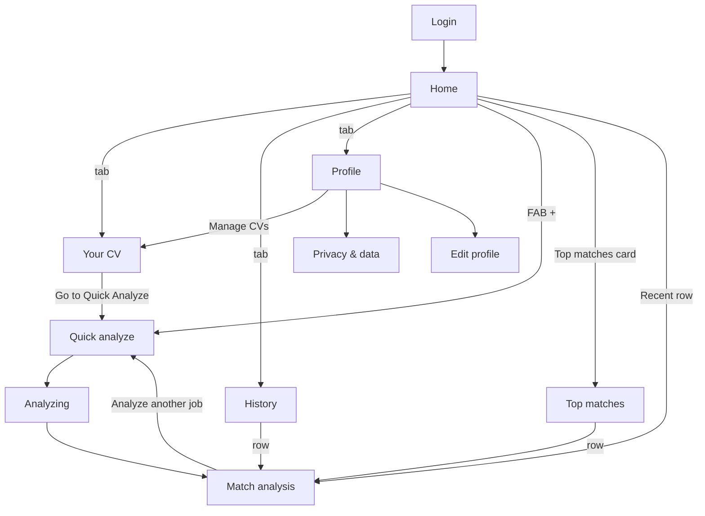

# Screens — RoleRadar (Expo)

Every screen the app needs. This doc is the **main layout reference**: screens are built directly in code from it, using DESIGN_SYSTEM.md tokens and components (no Figma). The low-fidelity screens of Oct 2026 only informed it.

For each screen this doc lists what is **required** (route, purpose, content, where each piece of data comes from, states, actions). Section order and layout follow the reference as a starting point and can change freely in the final design, as long as the required content and behaviour stay. **Notes on the reference** point out where the reference differs from the PRD, so the final design doesn't carry those over.

Shared layout rules: [DESIGN_SYSTEM.md §4](./DESIGN_SYSTEM.md#4-spacing-radius-elevation-layout). Data: [ARCHITECTURE.md §6](./ARCHITECTURE.md#6-storage-sqlite). Routes are Expo Router paths ([ARCHITECTURE.md §3](./ARCHITECTURE.md#3-navigation-expo-router)). Vocabulary: [PRD.md §4](./PRD.md#4-vocabulary-use-these-exact-words-in-ui-and-code).

## Screen map

---

## 1. Login — `/login` (not designed yet)

- **Purpose:** sign in with Google; only allow-listed accounts get in.
- **Sections:** app icon/name + one line ("Match job descriptions to your CV"); short privacy line ("Your CV and history stay on this phone."); **Continue with Google** button (bottom of the screen); in `__DEV__` builds only, a small "Dev sign-in" text button.
- **Flow:** tap → native Google account picker → "Signing you in…" → Home (or the screen the user was trying to open).
- **States:** default; signing in (button shows a spinner, disabled); cancelled (back to default, no message); not allowed ("This account doesn't have access to RoleRadar. Try another account." — the picker opens fresh next time); no Google Play Services (Android); offline ("You're offline — signing in needs a connection"); server error.
- **Notes on the reference:** no reference screen yet. The Google button must follow Google's sign-in branding guidelines (official "G" logo, "Continue with Google" / "Sign in with Google" wording, approved colours).

---

## 2. Home — `/` (tab: Home)

**Purpose:** where do I stand, and what should I do next?

| # | Section | Content | Data |
|---|---|---|---|
| 1 | Header | Avatar (Google photo, initials fallback; taps → Profile), bell (v1.3 reminders — hide in MVP), "Hello, {first name}", subtitle | `profile.name` / `profile.picture` (from Google at sign-in); subtitle = "{n} in interviews" where n = analyses with status `interviewing`; if 0 → "{n} jobs analyzed this week" |
| 2 | **This week** card | "Your average CV-to-job match score." Gauge with average %, label "Average match score" | Mean `result.score` of analyses created Mon–Sun this week (local time). Empty: "No analyses this week yet" + **Analyze a job** |
| 3 | **Active CV** card | Big average %, "Average match score"; rows: File name, Jobs analyzed, Last updated | Active `CvVersion`; average score + count of analyses with that `cvVersionId`; `updatedAt` |
| 4 | **Top matches** card (v1.1) | Stacked bar of unapplied jobs by verdict; top 3 rows "Title — Company · score%"; whole card opens Top matches | Analyses with status `not_applied`/`saved`, sorted by score |
| 5 | **Recent analysis** card | Latest 5 rows: title, company · date, score %, verdict chip, status chip; row opens Match analysis | Analyses by `createdAt` desc |
| 6 | Tab bar | Home · CV · History · Profile · (+) | — |

- **States:** first run (no CV → card "Start by adding your CV" with **Add CV**; CV but no analyses → This week/Recent empty states); offline banner.
- **Notes on the reference:**
  - The active tab is labelled "Analyze" but it's the Home tab — rename to **Home** (the (+) button is Analyze).
  - "4 interview scheduled" → we don't store interview dates; use "4 in interviews".
  - The last Recent row ("Label / Score / Verdict / Status") is a template row — remove.
  - Only the active tab has a label — add labels to all tabs (accessibility).
  - Keep sample/seed data consistent across screens (e.g. the same job shows 92% on Home but 35% on Match analysis).

---

## 3. Quick analyze — `/analyze` (from the (+) button, Top matches, CV, Match analysis)

**Purpose:** paste a job description and start the analysis.

| # | Section | Content |
|---|---|---|
| 1 | Page header | Back · "Quick analyze" · "Paste a job description to score it against your CV, with evidence for every requirement." |
| 2 | Text area | Fills the remaining height; placeholder "Paste the full job description here"; counter "0 / 20,000"; **Paste** button (top-right of the box) using the clipboard |
| 3 | Active CV line (add) | "Using: {cv.name} · Change" → CV tab |
| 4 | Bottom action | **Analyze** (sparkles icon), full width, stays above the keyboard |

- **States:** empty (Analyze disabled), too short (< 200 chars: "Add the full job post — at least 200 characters"), ready, no active CV ("Add your CV first" + button), offline (disabled + message), pre-filled from the share sheet (v1.1, iOS and Android, with a dismissible "Shared from another app" note; a shared link is shown but never fetched).
- **Behaviour:** on tap → cache check → Analyzing state (same route) → `router.replace('/analysis/{id}')`.
- **Keyboard:** the screen uses `KeyboardScreen`; the Analyze button rides above the keyboard; tapping outside dismisses it.
- **Notes on the reference:** input text should be 16 (placeholder looks ~12); add the Paste button and the "Using: CV" line.

---

## 4. Analyzing — `/analyze` (state)

**Purpose:** show progress during the 5–30 s Gemini call.

| # | Section | Content |
|---|---|---|
| 1 | Page header | Back (cancels the request and returns to the text) · "Analyzing your match" · "We're comparing your CV with the job requirements to identify your strengths and potential gaps." |
| 2 | Dot matrix | Animated wave of dots in a card |
| 3 | Progress text (add) | Rotating, announced to screen readers: "Reading the job description…" → "Checking requirements…" → "Scoring your match…" |

- **States:** running; retrying ("The AI is busy — retrying…" on 429 back-off); error (message + **Try again** + **Edit text**); offline mid-request.
- **Notes on the reference:** add the progress text under or over the dots — the animation alone doesn't tell screen-reader users or impatient users anything.

---

## 5. Match analysis — `/analysis/[id]`

**Purpose:** the result, and the place to set the application status.

| # | Section | Content | Data |
|---|---|---|---|
| 1 | Page header | Back · "Match analysis" · "Review your match results and application progress." | — |
| 2 | Summary card | Job title; "{company} · Analyzed {date}"; summary paragraph(s); **Gauge** with score % and verdict; rows **CV used**, **Application status** | `result.jobTitle`, `result.company`, `createdAt`, `result.summary`, `result.score`, `result.verdict`, CV name, `status` |
| 3 | Dealbreakers (add, only if any) | Red callout listing each dealbreaker and reason | `result.dealbreakers` |
| 4 | **Requirements breakdown** | Count chips "{n} Met · {n} Partial · {n} Missing"; rows: requirement title, evidence, status chip; must-have first, then Missing → Partial → Met; nice-to-haves grouped under a small "Nice to have" label | `result.requirements` |
| 5 | **Improve your application** | Tailoring tips · Strengths · Gaps (check lists) · Keywords (chips) | `result.tailoringTips`, `strengths`, `gaps`, `missingKeywords` |
| 6 | **Application tracking** | `StatusPicker` (bottom sheet: Not applied, Saved, Applied, Interviewing, Offer, Rejected); change saves immediately + haptic + toast | `status` |
| 7 | Bottom action | **Analyze another job** → `/analyze` | — |

- **States:** loaded from storage (instant, no AI call); not found (deleted/cleared) → "This analysis isn't on this device" + Back to History.
- **Notes on the reference:**
  - Verdict under the gauge says "Poor Fit" → use **Low match**.
  - The breakdown subtitle says missing is prioritized but the rows show Met first — sort **Missing → Partial → Met** within must-haves.
  - Keywords: label them "Keywords missing from your CV" (they come from `missingKeywords`) so they aren't confused with matched skills.
  - Add the dealbreaker callout (the PRD requires it to be visible when the score is capped).

---

## 6. Top matches — `/top-matches` (v1.1, from Home)

**Purpose:** which unapplied job should I apply to first?

| # | Section | Content | Data |
|---|---|---|---|
| 1 | Page header | Back · "Top matches" · "Discover your strongest job opportunities." | — |
| 2 | **Your match overview** | "How your unapplied jobs compare against your CV." Stacked bar + legend rows: Strong / Good / Partial / Low match with counts | Unapplied analyses grouped by `verdict` |
| 3 | **Highest-scoring opportunities** | Rows: title, company · date, score %, score bar, up to 3 matched-skill chips, verdict chip; row opens Match analysis | Unapplied analyses with verdict Strong or Good, sorted by score desc; chips = `label` of met must-have requirements of category skill/tool |
| 4 | (add) Quick status action | Trailing "Mark applied" button per row (swipe actions optional) | updates `status` |

- **States:** none unapplied ("You've acted on every match. Analyze another job.").
- **Notes on the reference:** the overview legend's "Partial/Low" counts include jobs that will never be "opportunities" — fine for the overview, but the list below should only show Strong and Good.

---

## 7. History — `/history` (tab: History)

**Purpose:** every analysis, searchable, with application progress.

| # | Section | Content | Data |
|---|---|---|---|
| 1 | Page header | "History" · "Revisit your analyses and track your applications." (no back button on a tab screen) | — |
| 2 | **Application overview** | Three stat tiles: Analyzed · Applied · Interviews | counts per PRD §9 F3 |
| 3 | **Analysis history** | Search field; rows (`FlatList`, the overview as its header): title, company · date, score %, score bar, verdict chip, status chip, CV version chip; newest first | all analyses (SQL `LIKE` on title/company) |

- **States:** empty ("No analyses yet" + **Analyze a job**); no search results ("No jobs match '{query}'"); offline (works normally).
- **Optional later:** status filter chips above the list.
- **Notes on the reference:** the History screen has a Back arrow, but it's a tab — remove it (tab screens don't go back). Status label "Interviewing" ✔ matches the PRD.

---

## 8. Your CV — `/cv` (tab: CV)

**Purpose:** add, review and manage CV versions.

### 8a. Empty
| # | Section | Content |
|---|---|---|
| 1 | Page header | "Your CV" · "Manage your resume and saved versions." |
| 2 | Upload card | "No CV uploaded yet" · "Upload a PDF or DOCX file to get started." · tappable area: icon, "Choose a file", "PDF or DOCX · Max 4 MB" → system document picker |
| 3 | Paste option (add) | "Or paste your CV text" link → opens the text editor without a file (works offline too) |
| 4 | Saved versions | Hidden when there are none |

### 8b. Uploaded / editing
| # | Section | Content | Data |
|---|---|---|---|
| 1 | **Your CV** card | "The resume currently used for job matching." MVP: `FileCard` (icon, file name, "PDF Document · {n} page(s)"); v1.1: page-1 preview image above it; pencil = replace file | `file_name`, `file_type`, `page_count` (`file_uri` for the v1.1 preview) |
| 2 | **Extracted CV Text** | Editable text box (max-height with its own scroll), counter "{n} / 30,000 characters" | `text` |
| 3 | **Version Details** | Name field, placeholder "e.g., CV – October 2026" | `name` |
| 4 | Bottom actions | **Save as New Version** (primary) · **Go to Quick Analyze** (secondary) | — |
| 5 | **Saved Versions** | Rows: name, chips "Active" (only one) + "Saved {date}", pencil → `/cv-version/[id]` (rename, set active, delete) | `cv_versions`, `activeCvId` |

- **States:** reading file ("Reading your CV…" while `/api/parse-cv` runs), offline (file picking disabled with a message; paste still works), unreadable file ("We couldn't read text from this file — paste your CV text instead" + empty text box), too large/wrong type, low text warning (< 300 chars), unsaved changes (confirm on leaving).
- **Notes on the reference:**
  - Both CV 1 and CV 2 show "Active" — only **one** can be active; the other gets a **Set active** action.
  - The empty screen shows a disabled **Analyze** button — replace with nothing (or "Add a CV to analyze") until a CV exists.
  - "Drag and drop" doesn't apply on phones — use "Choose a file".
  - The large preview area is v1.1 (needs a development build); the MVP shows a file card.
  - The extracted text looks ~11 — use 14–15 for reading, 16 when editing.
  - Long CV text inside a scrolling screen: give the text box a fixed max height with its own scroll, or open it full screen to edit.

---

## 9. Profile — `/profile` (tab: Profile)

| # | Section | Content | Data | Release |
|---|---|---|---|---|
| 1 | Page header | "Profile" · "Manage your profile and preferences." | — | MVP |
| 2 | Profile card | Google photo, name, email ("Signed in with Google"), headline, location, pencil → `/profile-edit` | `profile` (name/email/picture from Google; headline/location typed) | MVP |
| 3 | Preferences card | Active CV · Preferred job titles (chips) · Work arrangement (chips) · Preferred location · **Edit Profile** | `activeCvId`, `profile.*` | Active CV in MVP; the rest v1.2 |
| 4 | **Settings & privacy** | Manage CVs → CV tab · Privacy & data → `/privacy` · Help & support → `/help` · App version (value from `expo-application` / `expo-constants`) · Terms & Privacy → `/terms` | — | MVP (Notifications row v1.3) |
| 5 | Bottom | **Sign out** (confirm sheet: "Your data stays on this phone.") | — | MVP |

- **Notes on the reference:**
  - "Control how CareerSniper works for you" → use the confirmed app name (**RoleRadar**).
  - The Profile screen has a Back arrow but it's a tab — remove it.
  - Hide **Notifications** until v1.3.
  - Add "Last backup: {date}" under Privacy & data.

### 9a. Privacy & data — `/privacy` (not designed yet)
- What's stored and where ("Everything is stored on this phone. Your CV file is sent to RoleRadar's server only to read its text and isn't kept. Your CV text and the job description are sent to Google Gemini for each analysis, with email, phone and links removed.")
- **Export my data** (JSON file → share sheet: save to Files / Drive) · **Import data** (document picker, confirm overwrite) · **Delete all data** (confirm with typed "DELETE").

### 9b. Edit profile — `/profile-edit` (not designed yet)
- MVP: name (pre-filled from Google, editable), headline, location; email shown read-only. v1.2: preferred titles (chip input), work arrangement (multi-select chips), preferred location. **Save** in the bottom action bar.

---

## 10. Global states to design

- [ ] Offline banner (top, under the header)
- [ ] Toasts: "Status updated", "Version saved", "Data exported"
- [ ] Status picker bottom sheet
- [ ] App icon (iOS + Android adaptive icon) and splash screen
- [ ] Confirm sheets: sign out, delete version, delete all data, import overwrite
- [ ] First-run Home (no CV) and "Restore from backup"
- [ ] Session expired → Login ("Please sign in again"), then back to where the user was
